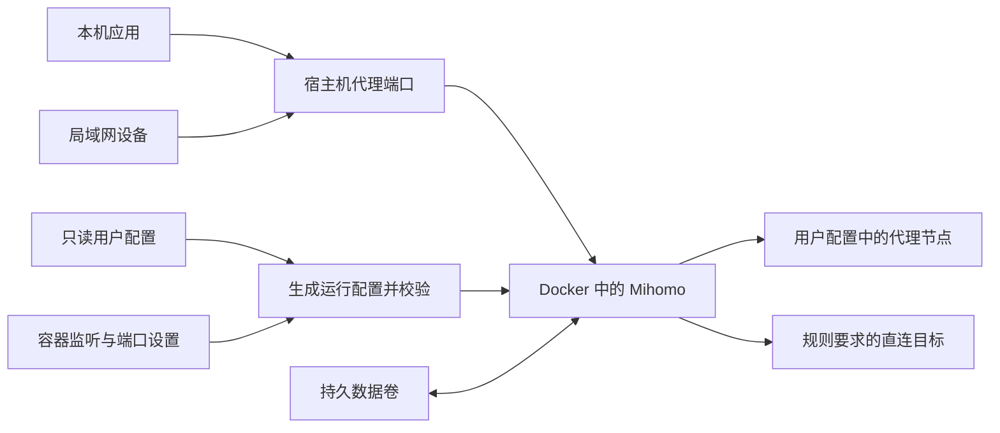

# clash-box 设计

状态：设计阶段。用户已选择 Mihomo，使用范围为本机和局域网设备。

## 目标与边界

提供一个通用镜像，用户在运行时挂载自己的 Clash/Mihomo YAML 配置即可启动代理。镜像不包含用户节点和订阅凭据，同一镜像可用于不同配置。

第一版提供显式 HTTP/SOCKS5 代理。局域网设备需在系统或应用中设置代理地址；应用是否遵循系统代理取决于客户端。整机流量接管、旁路由、TUN 和自动修改宿主机路由属于后续独立功能。

第一版支持完整的单文件 YAML。订阅链接自动更新、多配置管理和配置引用的外部文件另行扩展；不能把任意 OpenVPN/WireGuard 文件直接当作 Clash YAML 使用。

## 当前环境与可行性

已检查 `~/clash`，未改动其中的文件或正在运行的进程：

| 项目 | 现状 | 对设计的影响 |
| --- | --- | --- |
| 内核 | Clash 2023.08.17，Linux amd64，静态链接 | 现有运行环境简单；迁移后改用固定版本 Mihomo |
| 配置 | `config.yaml`，包含节点、策略组和分流规则 | 适合单文件只读挂载 |
| HTTP / SOCKS | `127.0.0.1:7890` / `127.0.0.1:7891` | 测试容器使用其他宿主机端口，避免冲突 |
| `allow-lan` | `false` | 容器内需改为允许外部连接，宿主机再控制端口发布范围 |
| 管理接口 | 监听 `0.0.0.0:9090`，未设置密钥 | 新方案的管理接口增加密钥，默认不发布到宿主机 |
| 地理数据库 / 缓存 | 存在 `Country.mmdb` 和 `cache.db` | 镜像提供初始数据库，缓存使用独立数据卷 |
| Docker / Compose | 已安装且 Docker 服务可访问 | 可直接开展构建和容器验证 |

已在临时目录中复制配置和数据库，运行旧内核的 `-t` 检查，退出码为 0。尚未执行 Mihomo 的配置检查或真实代理验证；旧内核检查成功不等于已确认迁移兼容。

## 结构



采用普通 Docker bridge 网络。此用法不需要 `privileged`、TUN 设备或修改宿主机路由。

计划交付以下文件，当前仅已创建仓库说明、设计和 Git 忽略规则：

```text
clash-box/
├── Dockerfile
├── compose.yaml
├── .dockerignore
├── .gitignore
├── .env.example
├── README.md
├── docker/
│   ├── entrypoint.sh
│   └── prepare-config.*
├── examples/
│   └── config.example.yaml
└── docs/
    └── design.md

# 用户部署时提供，忽略提交：
config/config.yaml
```

### 镜像

- 使用来自 Mihomo 官方发布渠道、经过验证的稳定版本，固定版本和校验值；实施时选定具体版本。
- 包含 TLS CA 证书和与该版本匹配的基础地理数据库，启动不依赖临时下载这些基础资源。
- 用户配置如果额外引用在线规则集或节点集，仍需要可访问对应来源；第一版先验证当前单文件配置。
- 首先验证当前 Linux amd64 主机；arm64 作为后续构建目标，不直接复用旧的 amd64 二进制。
- 普通代理以非 root 用户运行，运行缓存保存在可写数据卷中。

### 配置与数据

| 容器路径 | 用途 | 写入方式 |
| --- | --- | --- |
| `/input/config.yaml` | 用户原始配置 | 只读 bind mount |
| `/var/lib/mihomo/config.yaml` | 合并容器设置后的运行配置 | 启动时生成 |
| `/var/lib/mihomo/` | 数据库、缓存、节点选择状态和管理密钥 | 持久数据卷 |

入口程序使用 YAML 解析器合并配置，不用字符串替换修改 YAML。用户原始文件不回写，节点、策略组、规则和 DNS 语义保持不变；迁移不兼容项需单独验证和说明。

默认覆盖项如下：

- `allow-lan: true` 和 `bind-address: "*"`，使宿主机端口转发和局域网请求能进入容器。
- `port: 0`、`mixed-port: 7890`、`socks-port: 7891`，避免原 HTTP 端口与混合端口重复占用。
- `external-controller: 0.0.0.0:9090`，使用数据卷中首次生成并持久保存的随机密钥；默认不向宿主机发布管理端口。
- 第一版关闭 TUN、redir 和 tproxy 等透明代理入口。其他自定义监听器如有冲突，给出明确错误。
- 限制代理入口允许访问的地址范围为本机及私有局域网范围；用户已有的代理认证保留，可通过部署设置进一步收紧来源和启用认证。实际来源地址须在 Docker 网络验证中检查。

启动时先检查输入文件是否存在、是否为合法配置，再生成运行文件，执行 `mihomo -t`，通过后用 `exec` 启动内核，使 Docker 停止信号直接到达 Mihomo。缺失或无效配置要明确报错，日志不输出完整配置或凭据。

配置以只读文件挂载时，主机上通过原子替换更新文件可能改变 inode。第一版文档统一采用“替换配置后 `docker compose up -d --force-recreate`”的更新流程，以便重新挂载并重新生成运行配置。

### 网络与客户端

| 用途 | 容器端口 | 宿主机发布方式 |
| --- | --- | --- |
| HTTP / SOCKS5 混合代理 | `7890/tcp` | 默认提供本机和局域网访问，支持设置绑定 IP 和宿主机端口 |
| 兼容原 SOCKS5 入口 | `7891/tcp` | 默认保留，兼容当前客户端设置 |
| 管理 API | `9090/tcp` | 默认不发布；需要时单独映射到 `127.0.0.1` |

UDP 转发另行验证，第一版不宣称显式 HTTP/SOCKS 代理可以接管全部 UDP 流量。DNS 设置保留在 Mihomo 内部，不默认向局域网提供 DNS 服务。

客户端填写方式：

- 本机：代理服务器为 `127.0.0.1`，端口 `7890`。
- 局域网：代理服务器为 Docker 主机的局域网 IP，端口 `7890`；主机防火墙需允许目标局域网访问该 TCP 端口。
- 同一 Docker 网络中的其他容器：使用 Compose 服务名 `clash:7890`，不填写 `127.0.0.1`。

默认发布代理端口以支持局域网；多网卡主机可通过可选 `.env` 设置绑定地址。管理接口和将来的 Web 面板独立控制访问范围。

## 实施顺序与验收

1. 选定 Mihomo 版本，准备镜像和基础数据库；在隔离目录验证现有 YAML 兼容性。解析通过后仍需检查规则、DNS 与节点连接行为。
2. 实现配置合并、Dockerfile、Compose、无真实凭据的示例配置和构建上下文排除规则。
3. 用宿主机 `17890` / `17891` 启动测试容器，与仍在运行的旧 Clash 并行；通过 HTTP 和 SOCKS5 分别访问已知直连及代理目标。
4. 确认启动失败提示、管理端口默认不发布、配置更新、重启后状态保留和正常停止。
5. 从另一台局域网设备实测代理访问、访问范围和实际来源 IP。这一步需要一台可操作的客户端；容器本机检查不能替代局域网端到端验收。
6. 验证完成后再安排正式端口切换；保留旧 Clash 和原配置作为回退入口。

容器存活或健康检查通过只说明本地服务可用，节点是否可用和外网是否畅通应由单独的连通性检查报告。

## 后续扩展

按实际需要增加 Web 面板、订阅更新、arm64 镜像和 GitLab CI 镜像构建。TUN / 旁路由单独设计网络与权限配置。

## 参考资料

- [Mihomo 代理端口：HTTP、SOCKS 与 mixed-port](https://wiki.metacubex.one/en/config/inbound/port/)
- [Mihomo 通用配置：局域网访问、认证和管理接口](https://wiki.metacubex.one/en/config/general/)
- [Docker Compose 网络与服务名访问](https://docs.docker.com/compose/how-tos/networking/)
- [Docker Compose 服务配置：端口映射与只读文件挂载](https://docs.docker.com/reference/compose-file/services/)
