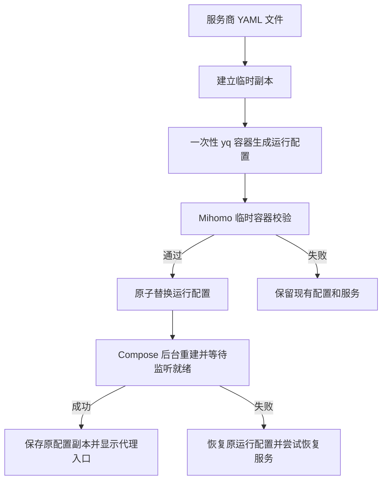

# clash-box 部署设计

## 目标

使用者 clone 仓库、下载服务商的完整 Clash/Mihomo YAML 后，执行 `./start.sh /路径/配置.yaml` 即可后台启动，无需手动修改监听字段。运行核心直接使用官方 Mihomo 镜像。

本机和局域网设备通过系统或应用设置 HTTP/SOCKS5 代理。整机流量接管、旁路由、UDP 和 TUN 暂不纳入。

## 启动流程

脚本只有 Bash 和 Docker/Compose 依赖。YAML 使用固定版本 `mikefarah/yq:4.54.1` 的一次性容器解析，不在宿主机安装工具，也不制作自定义镜像。工具容器从标准输入读取副本、向标准输出写生成配置，处理时禁用网络和 Docker 日志。

## 配置和数据

| 位置 | 内容 | 更新方式 |
| --- | --- | --- |
| 用户指定的源文件 | 下载的服务商配置 | 保持不变 |
| `config/config.yaml` | 最近成功启动的服务商配置副本 | 启动成功后保存 |
| `runtime/config.yaml` | 适合部署的运行配置 | 通过校验后原子替换 |
| `runtime/start.log` | 校验和失败详情 | 每次启动重新生成 |
| `.env` | 可选镜像版本、宿主机端口、绑定 IPv4 地址、时区 | 用户需要时设置 |
| Docker 命名卷 | 数据库、缓存和状态 | Docker / Mihomo 管理 |

Compose 将 `runtime` 目录只读挂载到 `/etc/mihomo`，同时用于校验临时文件和读取正式配置；数据卷挂载到官方目录 `/root/.config/mihomo`。源配置、临时文件、生成配置、日志和 `.env` 不进入 Git。新建的私有目录和文件使用 `umask 077`。

无参数时优先读取仓库的 `config/config.yaml`，其次读取根目录 `config.yaml`。带参数的相对路径在切换工作目录前解析，因此从其他目录执行也可用。启动锁防止两个脚本同时替换运行配置，正常退出和信号中断时清理临时文件及锁。

## 自动适配范围

用 YAML 解析器确认只有一个文档且顶层为映射，展开锚点，再统一设置：

- `port: 0`、`mixed-port: 7890`、`socks-port: 7891`。
- `allow-lan: true`、`bind-address: "*"`，允许本机和私有 IPv4 地址段，清空会阻止这些请求的来源黑名单。
- 关闭 HTTP/TLS/Unix/Pipe 管理入口、TUN、iptables 自动规则和 redir/tproxy。

节点、策略组、规则、DNS、账号及代理认证保留。未知字段由 Mihomo 最终校验；HTML、标量、数组和多文档输入在生成阶段拒绝。配置引用的额外本地文件需要用户另行挂载。

## 后台运行和失败处理

Compose 使用 bridge 网络，将宿主机 `7890/7891` 默认映射到容器相同端口。`.env` 可只改变宿主机端口或绑定 IPv4 地址。管理 API 不发布，普通代理不申请额外网络权限。

健康检查使用官方镜像自带的 `nc` 确认两个 TCP 代理入口可连接；脚本用 `up -d --force-recreate --wait` 等待就绪。它不证明上游节点或外网可用。Docker 负责 `unless-stopped` 重启策略和带轮转的本地日志。

解析失败或 Mihomo 校验失败不替换当前运行文件，也不重建已有服务。后台启动失败恢复旧运行文件；若原服务此前运行，尝试按当前部署参数恢复。端口和镜像版本不自动回退，恢复失败时明确报错。首次启动失败时停止失败的服务，避免重复重启。

源配置和运行配置分开，因此失败的更新不会污染上一份可用运行文件。升级或调整端口前仍应记录原 `.env` 和数据状态，必要时恢复相应部署参数再执行脚本。

## 数据库与版本

固定官方标签 `v1.19.33`，可通过 `.env` 覆盖。官方镜像提供初始地理数据库，Docker 在首次创建空命名卷时复制镜像目录内容，后续继续使用该卷。镜像升级不会覆盖已存在的卷数据，数据库更新由 Mihomo 原生机制或单独维护处理。

## 验收

真实 Docker 集成测试覆盖锚点及引号、保留节点与认证、从仓库外使用包含空格和中文的路径、HTTP/SOCKS5 请求、无参数重启、坏配置拒绝、启动失败恢复和并发锁。使用独立 Compose 项目及临时端口，测试后清理容器和数据卷。

用户当前旧 Clash 在 `7890/7891` 运行，新服务采用 `17890/17891` 并行验证。正式端口切换单独安排，不自动停止旧服务。跨物理设备的局域网访问仍需客户端实测，详见 [迁移说明](migration.md)。

## 官方参考

- [Mihomo 官方镜像](https://hub.docker.com/r/metacubex/mihomo)
- [所选版本的官方 Dockerfile](https://github.com/MetaCubeX/mihomo/blob/v1.19.33/Dockerfile)
- [Mihomo 通用配置](https://wiki.metacubex.one/config/general/)
- [yq 项目与 Docker 用法](https://github.com/mikefarah/yq)
- [Docker Compose 服务配置](https://docs.docker.com/reference/compose-file/services/)
- [Docker 数据卷](https://docs.docker.com/engine/storage/volumes/)
