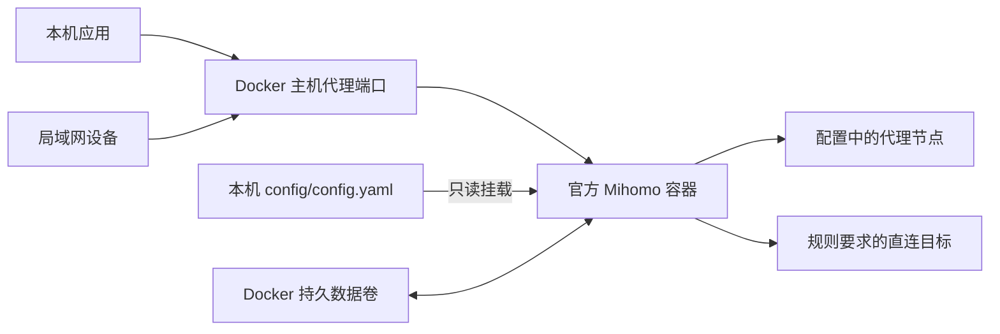

# clash-box 部署设计

## 定位

这是个人 Mihomo 部署配置仓库。运行核心由官方镜像提供，仓库维护 Compose 配置、脱敏示例、使用说明和版本选择。用户提供完整的 Clash/Mihomo YAML，首次适配部署相关字段后启动。

第一版面向当前 Linux 主机，同时服务本机和局域网设备。使用系统或应用显式设置的 HTTP/SOCKS5 代理。官方镜像的其他平台支持可按部署设备单独验证。

## 部署结构



采用普通 bridge 网络，发布代理端口。此用法无需宿主机网络模式、TUN 设备或额外网络管理权限。

## 目录和职责

```text
clash-box/
├── compose.yaml
├── .env.example
├── .gitignore
├── README.md
├── examples/
│   └── config.example.yaml
└── docs/
    ├── design.md
    └── migration.md

# 部署时创建，Git 忽略：
.env
config/config.yaml

# Docker 管理，不在仓库目录内：
# mihomo-data 命名卷
```

| 层次 | 内容 | 谁维护 |
| --- | --- | --- |
| 运行程序 | Mihomo 内核、镜像内证书及初始数据库 | 上游官方镜像 |
| 部署配置 | 镜像版本、端口、挂载、重启和日志策略 | 本仓库 |
| 代理配置 | 节点、凭据、分流、DNS、代理监听设置 | 本机私有 `config/config.yaml` |
| 运行数据 | 数据库、缓存、节点选择状态 | Docker 命名卷及 Mihomo |

真实配置仅运行时挂载，仓库不包含自建镜像或构建流程。第一版不引入配置合并脚本、包管理器和订阅转换服务。

## 两份配置各管什么

`.env` 是 Compose 的本地参数，包括官方镜像版本、宿主机端口、端口绑定 IPv4 地址和时区。它不会改写 `config.yaml`，也不会自动成为 Mihomo 的配置项。

`config/config.yaml` 由 Mihomo 原生读取。第一次从旧 Clash 复制时，手动调整监听设置：关闭原 `port`，使用 `mixed-port: 7890` 和 `socks-port: 7891`，开启 `allow-lan`，容器内绑定 `"*"`，关闭默认管理 API 和 TUN。其余配置先保持原样，再通过 Mihomo 校验兼容性。

后续替换服务商提供的完整配置时，也需检查这些字段。随着使用经验增加，可以再评估 Mihomo 原生 `proxy-providers` 是否适合把可更新的节点集与固定部署配置分开。

## 端口与访问

| 用途 | 容器端口 | 默认宿主机端口 |
| --- | --- | --- |
| HTTP / SOCKS5 混合代理 | `7890/tcp` | `7890` |
| 兼容原 SOCKS5 入口 | `7891/tcp` | `7891` |
| 管理 API | 默认关闭 | 不发布 |

默认监听宿主机 IPv4 接口，以满足本机和局域网共同访问。可以设置 `PROXY_BIND_IP` 限定目标接口。容器内 `bind-address` 仍为 `"*"`，不能填写宿主机局域网 IP。

代理配置示例允许本机和私有 IPv4 地址段；实际部署可收紧为所在网段，并使用 Mihomo 原生 `authentication`。Docker 对客户端来源地址的处理需在当前主机和局域网客户端上实测，访问范围不能只靠端口名称判断。

同一 Compose 网络中的应用可用 `mihomo:7890` 访问。第一版仅发布 TCP；UDP、整机代理、TUN 和旁路由按实际需求单独设计。

## 配置和数据的挂载

- `./config/config.yaml` 只读挂载到 `/etc/mihomo/config.yaml`，使用 `-f` 显式指定。文件必须存在，禁止缺失时自动建目录。
- `mihomo-data` 挂载到官方数据目录 `/root/.config/mihomo`，用 `-d` 显式指定。
- 官方镜像包含初始地理数据库。首次创建空命名卷时 Docker 默认复制镜像目标目录中的内容；后续重建使用已有数据。
- 镜像升级不覆盖已有卷内容。数据库需要更新时使用 Mihomo 原生配置或单独维护数据；内核版本和数据版本分别管理。
- 用户代理配置单独备份；如依赖缓存、选择状态或本地规则集，也备份数据卷。常规停止使用 `docker compose down` 保留命名卷。

后续若配置引用本地规则或节点文件，需按其容器路径增加只读挂载；当前已有配置的节点和规则均在单文件中。

## 版本和维护策略

Compose 默认使用明确的官方版本标签 `v1.19.33`，本地可在 `.env` 覆盖。该标签已核对存在于官方镜像仓库，但尚未在本机验证。初期固定正式版本，升级由人工选定并记录；需要更严格固定时可进一步锁定镜像 digest。

Docker 负责 `unless-stopped` 重启策略。日志使用带轮转的本地日志驱动，通过 Compose 查看。当前阶段不增加需要自定义镜像的探针或自动升级任务。

维护操作统一为原生 Compose 命令：拉取镜像、用一次性容器执行 `-t`、启动、查看日志、重建和停止。配置替换后重建容器，确保文件 bind mount 指向新的文件。

## 迁移与验收

当前 `~/clash` 的版本是 Clash 2023.08.17；原配置已在旧内核临时目录检查通过。Mihomo 对该配置的兼容性仍需验证。

先用宿主机 `17890/17891` 与旧 Clash 并行验证，保留旧服务。依次检查新内核解析、本机 HTTP/SOCKS5、指定代理节点的真实连接、直连和分流，以及另一台局域网设备。旧服务使用的正式端口只在验证后切换，具体步骤见 [迁移说明](migration.md)。

## 可选扩展

需要浏览器切换节点时再增加管理 API 和 Web 面板。可以使用现有 MetaCubeXD 面板；管理 API 配置密钥，宿主机发布范围单独设置。需要节点自动更新时优先使用 Mihomo 原生 provider 能力。GitLab 先用于存储部署配置，无需镜像构建流水线。

## 官方参考

- [Mihomo 镜像与版本标签](https://hub.docker.com/r/metacubex/mihomo/tags)
- [所选版本官方 Dockerfile：入口、证书、数据库和数据目录](https://github.com/MetaCubeX/mihomo/blob/v1.19.33/Dockerfile)
- [Mihomo 通用配置](https://wiki.metacubex.one/config/general/)
- [Mihomo 代理端口](https://wiki.metacubex.one/config/inbound/port/)
- [Docker Compose 服务配置](https://docs.docker.com/reference/compose-file/services/)
- [Docker 数据卷的首次填充行为](https://docs.docker.com/engine/storage/volumes/)
